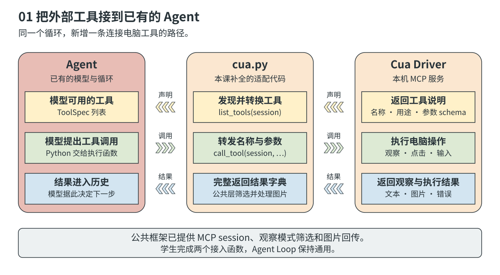
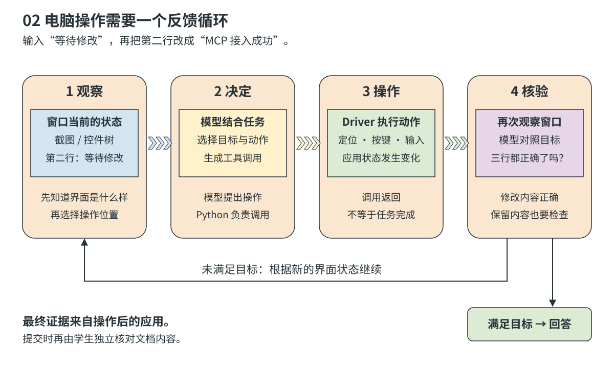
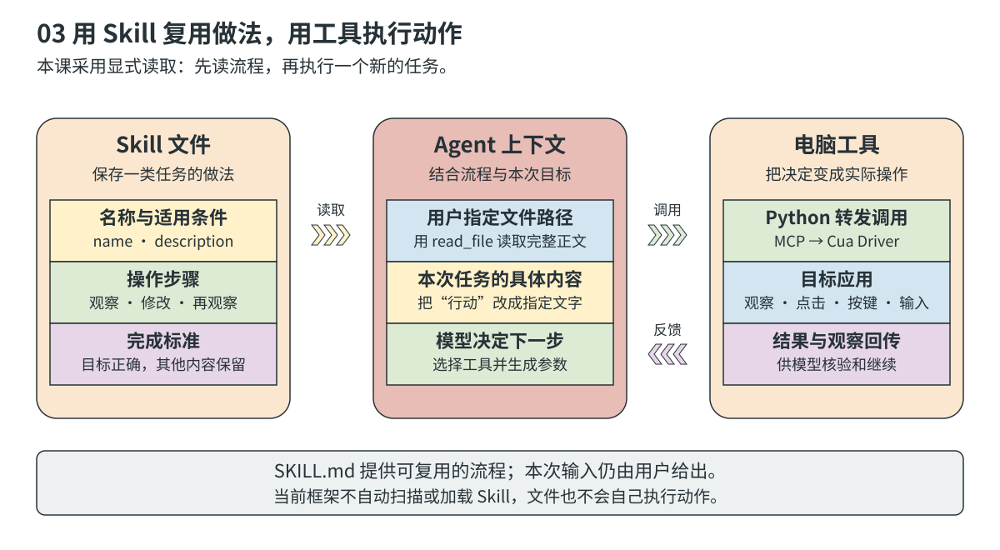

# Lesson 02 · MCP、CUA 和 Skill 到底是什么？

第一课里，我们写了一个 Agent：模型想好下一步，程序执行工具，再把结果交给模型。这样反复进行，直到任务结束。

这一课，我们想让它做一件更具体的事：

> 在已经打开的文本编辑器里输入三行文字，再把第二行改成“MCP 接入成功”。

要完成这件事，Agent 得能连接电脑工具、看到界面、点击和输入。如果下次还要做类似的事，我们也希望它能复用这次的做法。

这就用到了本课的三个概念：

| 名称 | 先用一句话理解 |
| --- | --- |
| MCP | 让 Agent 按照统一的约定连接和调用外部工具 |
| CUA | 让 Agent 看着界面操作电脑 |
| Skill | 把一类任务的做法写下来，让 Agent 可以反复参考 |

下面每一部分都回答三个问题：**它是什么？为什么要用它？它是怎么工作的？**

## 一、MCP：Agent 和外部工具怎么接上？

### 是什么？

MCP 的全名是 Model Context Protocol。名字看起来有点复杂，先把它理解成 **Agent 和工具之间共同遵守的一套沟通规则**。

比如，一个程序能帮你截图、点击和输入。它需要告诉 Agent：

- 我能做哪些事。
- 每件事叫什么，需要你提供什么信息。
- 做完以后，我会怎样告诉你结果。

双方都按 MCP 的约定来，就可以用统一的方式交换这些信息。提供这些能力的程序叫 MCP 服务；Agent 这边负责连接它的部分叫 MCP 客户端。

本课使用的 **Cua Driver** 就提供了这样的服务。它负责与本机桌面打交道，把截图、点击、输入等能力交给 Agent 使用。

### 为什么要用它？

第一课的计算工具就在我们自己的 Python 项目里，直接写代码调用就行。但外部工具可能来自不同程序：一个负责查文档，一个负责读数据库，还有一个负责操作电脑。

如果它们各有一套接法，每多接一个，我们都要重新了解它怎样介绍工具、怎样接收请求、怎样返回结果。

MCP 把这些共同的部分统一起来。Agent 可以先问服务“你有哪些工具”，再按服务给出的说明使用工具。服务内部怎么截图、怎么查数据库，仍由提供工具的人实现。

所以，**当我们想接入别人提供的工具时，MCP 能减少重复的接入工作**。自己写的一个简单 Python 函数，仍然可以直接调用，不必为了使用工具就加上 MCP。

### 它的原理是什么？

把过程拆开，其实只有两件事：**先拿到工具说明，再按说明调用。**



*图 1：上面一行是“告诉我有哪些工具”，下面两行是“请执行这个工具”和“这是执行结果”。*

先看工具说明。比如 Driver 告诉 Agent：“我有一个列出窗口的工具，还有一个获取窗口状态的工具。”每个工具都有名称、用途和参数要求。课程代码把这些说明交给模型，模型才知道自己可以用什么。

再看实际调用。你要求修改文档，模型可能先提出“列出当前窗口”。Python 把这次请求交给 Driver，Driver 执行后返回窗口列表。模型读到列表，才能继续选择要观察哪个窗口。

这里的分工是：**模型决定用什么，Python 负责发起调用，Driver 负责执行电脑操作。** MCP 规定它们之间怎么传信息。

在 [cua.py](cua.py) 中，这两件事正好对应两个待完成的函数：

| 函数 | 用大白话说，它要做什么 |
| --- | --- |
| `list_tools(session)` | 问 Driver 有哪些工具，把说明整理成模型能用的格式 |
| `call_tool(session, name, arguments)` | 把工具名称和参数交给 Driver，再完整带回结果 |

结果里可能有文字、图片，也可能有错误信息。它们都要保留：丢了图片，模型可能看不到界面；丢了错误，模型可能误以为操作成功。连接的建立和关闭已经由框架处理，你只需要补上这两个函数。

## 二、CUA：Agent 怎么看着界面操作电脑？

### 是什么？

CUA 是 Computer-Using Agent，也就是 **会通过界面使用电脑的 Agent**。

你操作软件时，会先看看窗口里有什么，再点击按钮、输入文字，最后看一眼有没有做对。CUA 也是类似的过程：取得界面信息，让模型判断下一步，再通过工具执行鼠标和键盘操作。

本课里的两个名字很像，要分清楚：**CUA 指这种 Agent，Cua Driver 是帮助它操作电脑的具体程序。**

### 为什么要用它？

有些任务有现成的接口。例如，要修改一个文本文件，可以直接用文件工具。但有些软件没有适合的接口，或者任务本身就要求在界面上完成，比如填写应用里的表单、调整软件选项、检查某个按钮是否生效。

这时候，Agent 需要能够使用人平时操作的界面。CUA 让它可以通过看、点、输入来完成这些任务。

这种方式也有难处：按钮可能被挡住，窗口可能切错，页面可能还没加载完。因此，电脑操作不能只发出一串点击命令，还得不断查看实际发生了什么。

### 它的原理是什么？

CUA 最重要的过程是：**看一下 → 决定怎么做 → 动手 → 再看一下。**



*图 2：点过了，不代表点对了。再次观察，才能知道操作有没有达到目的。*

还是拿修改第二行举例。Agent 先看到文档里有三行，第二行是“等待修改”。模型据此决定怎样选中第二行，再让工具输入“MCP 接入成功”。输入以后，Agent 重新获取窗口状态，检查第二行是否正确，也检查第一行和第三行有没有被误改。

如果文字没变，就要根据新看到的情况决定怎么修正。如果已经改好，才可以告诉用户完成了。第一课的 Agent Loop 仍然在工作，只是现在调用的工具能观察和改变电脑界面。

那么，Agent 到底怎么“看”界面？本课提供三种方式：

| 方式 | 给模型看什么 | 可以怎样理解 |
| --- | --- | --- |
| 纯视觉 | 窗口截图，以及必要的窗口和坐标信息 | 给它看一张界面照片，让它找文字和位置 |
| 可访问性树 | 应用提供的按钮、输入框、文字、层级等信息 | 给它一份“这个窗口里有哪些东西”的清单 |
| 混合 | 截图和可访问性树 | 照片和清单一起参考 |

“可访问性树”里的“树”，说的是包含关系：窗口里有面板，面板里有按钮和输入框。它可能直接告诉模型“这里有一个叫保存的按钮”，模型就不必只靠图片猜位置。但有些应用没有提供完整的清单，画布上的内容也可能只在截图里看得到。

因此，这三种方式值得用同一个任务比较。看看失败发生在哪里：没看到目标、找错位置、操作没生效，还是操作后没有检查。不要只凭一次结果就判断哪种方式最好。

还要记住：**界面会变，下一次动作要依据新的观察。** 上一次找到的位置或控件标记，到了下一步不一定还能用。最终是否完成，也要自己看目标应用确认，不能只看模型最后说了什么。

## 三、Skill：怎样让 Agent 复用一套做法？

### 是什么？

Skill 可以理解为 **写给 Agent 的任务说明书**，告诉它遇到某一类任务时，应该怎样做。

比如，我们可以写一份“通过界面修改文本”的说明：先确认窗口，读取当前文字，只修改用户要求的部分，改完再检查，遇到问题就重新观察。

这份说明通常放在一个叫 `SKILL.md` 的文件里。里面写清楚什么时候适用、具体步骤和完成标准。需要时，还可以附上示例、模板或脚本。

### 为什么要用它？

第一次让 Agent 修改文档时，你可能写了一长段要求：“先看清楚窗口”“不要改其他行”“完成后检查一遍”。

第二次换了一段文字，这些要求还是一样。如果每次都重新输入，容易漏掉，也不方便修改。把共同的做法放进 Skill，下次就可以让 Agent 先读这份说明，再处理新的内容。

例如，“只改指定行，最后检查其他行”可以一直复用；“把第二行改成什么”则由本次任务决定。**Skill 保存通用做法，用户请求提供这次要做的事。**

### 它的原理是什么？

Skill 能起作用，是因为 **Agent 读到了说明，模型把这些说明和当前任务一起作为判断下一步的依据**。



*图 3：Skill 提供做法，模型决定下一步，工具执行动作。*

可以把一份简单的 Skill 写成这样：

```markdown
---
name: edit-desktop-text
description: 在已打开的文本编辑器中修改指定文字，并检查结果。
---

# 通过界面修改文本

1. 先确认用户要修改哪个窗口、哪些文字。
2. 用 Cua 观察窗口，了解当前内容。
3. 根据最新观察，只修改用户指定的部分。
4. 改完再观察，检查目标文字和需要保留的内容。
5. 没改对就根据新观察修正；做不到就说明卡在哪里。
6. 最后根据实际界面说明结果，未经要求不保存或关闭文档。
```

其中，`name` 是名称，`description` 简要说明适用场景，正文写具体做法。换一个文档时，这些步骤仍然可以使用，不需要把固定坐标或上次的窗口编号写进去。

有些 Agent 系统会先把可用 Skill 的名称和介绍交给模型，任务匹配时再读取全文。**本课还没有自动查找和加载 Skill 的功能**，我们先用已有的文件读取工具，体验最直接的做法。

你可以把上面的内容保存到 `lesson_02_computer_use/skills/edit-desktop-text/SKILL.md`，然后对 Agent 说：

> 先用 read_file 完整读取 lesson_02_computer_use/skills/edit-desktop-text/SKILL.md，再按其中的步骤，把我已打开的练习文档第二行改成“MCP 接入成功”，保留其他行。

读取后，文件内容进入当前对话，模型才能参考它。仅仅把文件放在目录里，Agent 不会自动知道它存在。

Skill 也没有重新训练模型，更不会自动给它增加电脑权限。想让它点击，仍然需要接通点击工具；想知道它有没有按说明做，要看实际调用记录和最后的应用状态。

## 把三者放到同一个任务里

现在再看“修改文档第二行”这件事：

| 你遇到的问题 | 谁来解决 | 在本课里怎么做 |
| --- | --- | --- |
| 想用电脑工具，怎样接上？ | MCP | 按共同约定取得工具说明、发起调用、接收结果 |
| 接上以后，怎样完成界面操作？ | CUA | 观察文档、选择动作、执行、再观察 |
| 下次还要这样做，怎样少重复交代？ | Skill | 先读取保存好的流程，再处理新的任务内容 |

它们可以配合使用，也各有用途。MCP 还能接入与电脑操作无关的工具；Skill 也可以指导写报告、改代码等任务；CUA 的电脑工具则可以通过 MCP 或其他方式接入。

## 动手试一次

第二课已经提供 [agent.py](agent.py) 的完整循环和 [tools.py](tools.py) 的文件工具，不依赖第一课作业是否完成。先按[根目录说明](../README.md#本机-cua)安装并授权 Cua Driver，再和 Agent 一起补全 [cua.py](cua.py) 的两个函数。

在项目根目录启动第二课；第一课服务还在运行时，先停止它，或为第二课指定其他 `--port`：

```bash
uv run mini-agent --lesson 2 --open
```

Driver 尚未接通时，普通对话和文件工具仍然可用。完成代码后，运行接入检查：

```bash
uv run python scripts/check_student.py cua --lesson 2
```

这个检查不调用模型，只确认能取得工具列表并列出窗口。检查通过后，再选一个支持图片输入和工具调用的模型，打开文本编辑器，新建空白练习文档，在普通对话里发送：

> 只通过 Cua 操作我已打开的文本编辑器。在空白文档中输入“第一行”“等待修改”“第三行”三行文字，再把第二行改成“MCP 接入成功”，保留其他两行。操作前后都观察窗口，不用 bash 或文件工具代替界面操作，不要保存或关闭文档。

先试混合模式，再换成纯视觉和可访问性树。每次保持模型和任务相同，新建对话，并手动把应用恢复成空白文档。当前框架仍提供 bash 和文件工具，需要检查记录，确认这次确实通过 Cua 完成。

最后再加入 Skill，换一组文字试试。每次都看两件事：**应用里到底改成了什么，Agent 是怎样一步步做到的。** 停止运行或清空聊天都不会撤销已经发生的电脑操作。

具体函数接口见[接口契约](../docs/student/CONTRACT.md)，记录和提交要求见[作业说明](../docs/student/ASSIGNMENT.md)。

## 延伸阅读与插图说明

- [OpenAI Docs：Skills](https://developers.openai.com/plugins/concepts/skills)：Skill 的组成，以及它和工具的关系。
- [OpenAI Docs：Computer use](https://developers.openai.com/api/docs/guides/tools-computer-use)：观察、操作和检查结果。本课使用 Cua Driver，具体接口与该指南示例不同。
- [Unity ECS concepts](https://docs.unity3d.com/Packages/com.unity.entities@0.9/manual/ecs_core.html)：插图风格参考。三张图为课程原创 SVG，借鉴浅色块、分组和箭头，内容描述本课 Agent。
